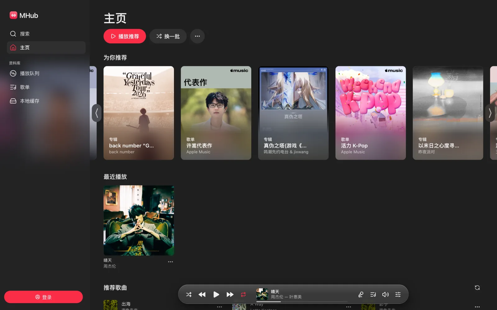
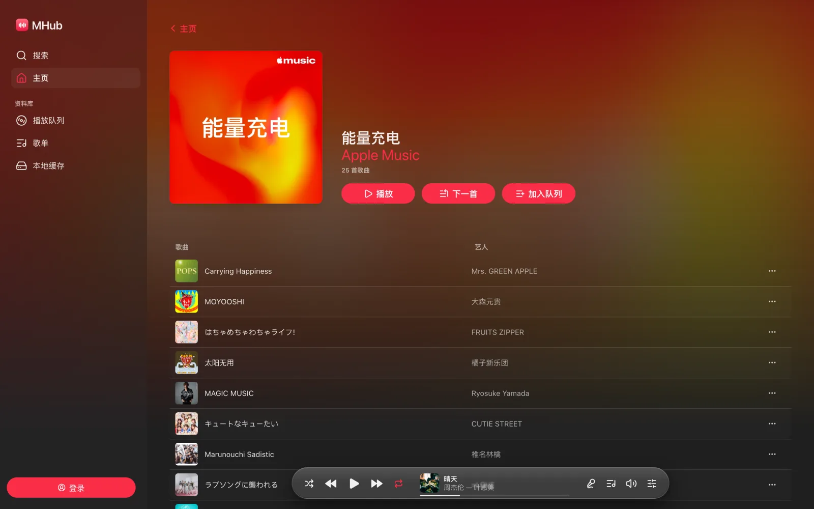
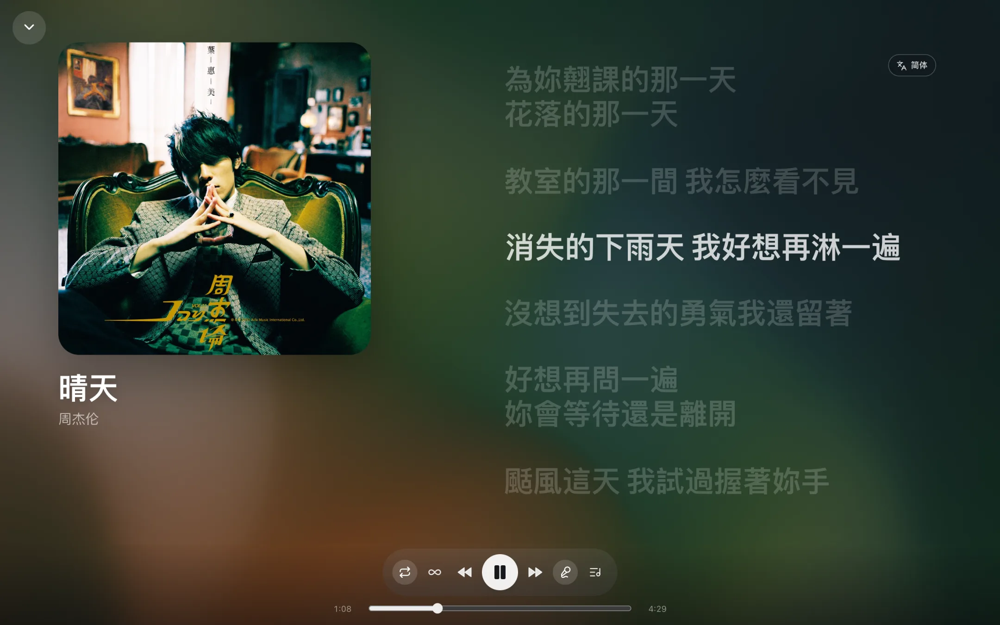
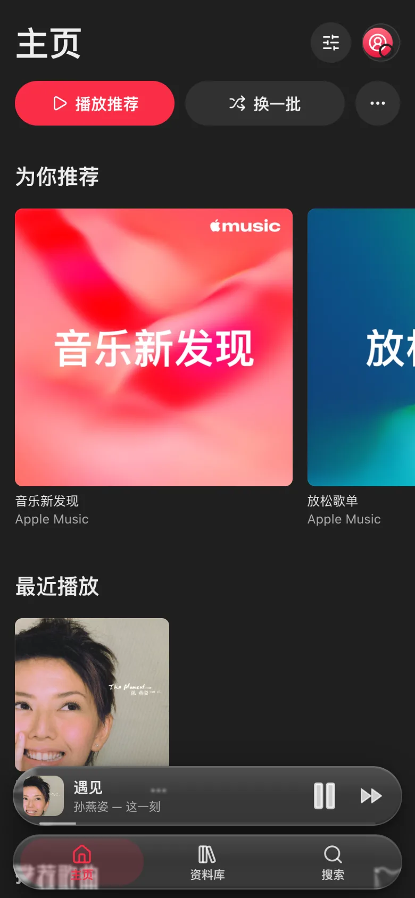
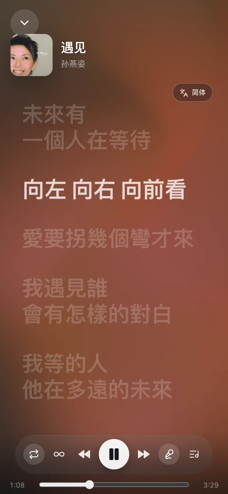
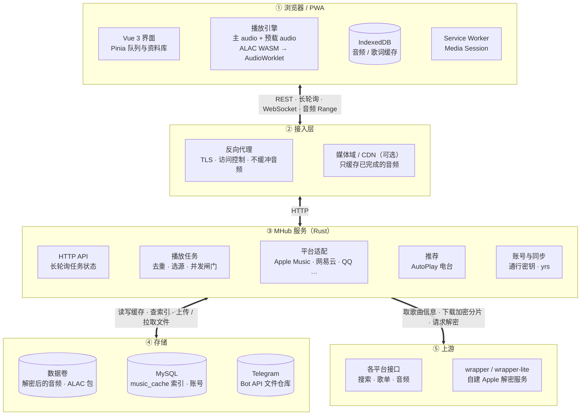
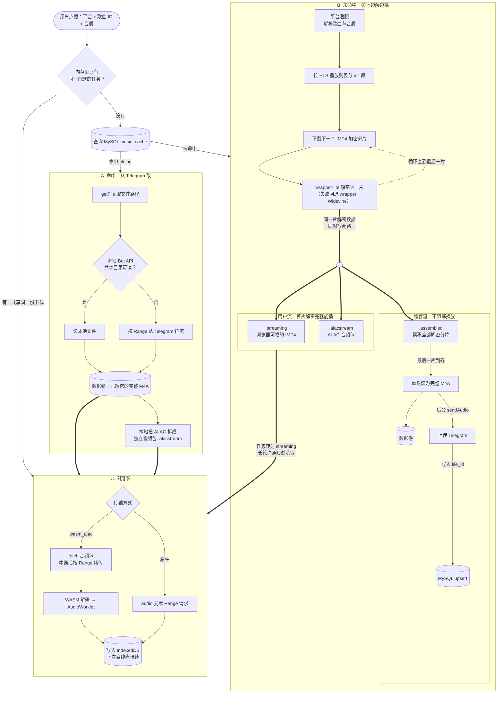

# MHub

[](https://github.com/jizizr/mhub/actions/workflows/ci.yml)
[](LICENSE)

自托管的多平台音乐播放器。把 Apple Music、网易云、QQ 音乐等平台的搜索、歌单和推荐收进一个队列里，在浏览器里无损播放，界面按 Apple Music 网页版的布局和交互来做。

[部署指南](docs/deployment.md) · [架构说明](docs/architecture.md) · [参与贡献](CONTRIBUTING.md) · [许可证](#许可与版权)

<p align="center">
  
</p>
<p align="center">
  
  
</p>
<p align="center">
  
  &nbsp;&nbsp;
  
</p>

## 功能

- **多平台**：搜索、歌单导入、跨平台匹配，同平台导入的歌单每天自动跟随原歌单同步。
- **队列**：追加、替换、下一首播放、拖动排序、随机与循环；自动续播使用 Apple Music 的 AutoPlay 电台。
- **无损播放**：ALAC 在浏览器里用 WASM 解码，通过 AudioWorklet 输出；其余格式走原生 `<audio>`。音质按播放时的设置选择。
- **后台播放**：锁屏或切到后台时连续播放下一首，系统媒体通知和控制保持可用。
- **歌词**：逐字歌词、流动的封面取色背景、简繁转换。
- **离线**：音频和歌词缓存在 IndexedDB，可安装为 PWA，断网后已缓存的歌照常播放。
- **账号（可选）**：通行密钥登录，资料库跨设备实时同步，在另一台设备上「接着听」。

可用能力取决于各平台的账号、地区和上游接口。本仓库不提供任何账号、会话或媒体文件，Apple Music 播放需要自行配置账号和 wrapper 服务。

## 技术栈

| 部分 | 使用 |
| --- | --- |
| 后端 | Rust 2024 · Axum · Tokio · reqwest · sqlx（MySQL，可选）· yrs · webauthn-rs |
| 前端 | Vue 3 · Pinia · Vite · Yjs · lucide 图标 |
| 播放 | 原生 `<audio>` · Rust ALAC 解码器编译为 WASM · AudioWorklet · Media Session |
| 歌词 | Apple Music-like Lyrics（AMLL）· OpenCC |
| 部署 | Docker 多阶段构建 · Compose · 任意 HTTPS 反向代理 |

## 架构

### 部署层级



### 一首歌的数据流



命中缓存时，Telegram 里存的就是解密后的完整文件，不再经过 wrapper；未命中时，每解密一片就同时写给用户和缓存，首片到手就能开播，Telegram 上传在整首下载完后后台进行，不占播放的时间。模块边界和账号同步的细节见[架构说明](docs/architecture.md)。

## 实现思路

**一首歌怎么播出来。** 前端只认「平台 + 歌曲 ID + 音质」。点击播放时，后端为这首歌建一个播放任务：选源、下载或解密、做响度分析，ALAC 再拆成独立的音频包，以流的方式交给浏览器。前端用长轮询等任务状态，而不是定时刷新。音频一边下一边播，同时写进 IndexedDB，下次直接从本地读。

**为什么后台不会断。** 移动浏览器在一首歌结束后，会把这个播放器移出系统媒体会话，锁屏时通知随即消失，页面也可能被冻结。所以下一首完整缓存后，会预先放进第二个 `<audio>`，在当前曲结束前静音起播，结束瞬间无缝接上。系统看到的始终是一个正在播放的播放器。

**续播推荐。** 和 Apple Music 网页版一样，用队列里最近十首歌创建 AutoPlay 电台，之后从同一个电台接着取。Apple 暂时不可用时，退回「同歌手 + 相似歌手」的推荐。

**资料库同步。** 每个账号的歌单是一份 Yjs 文档，通过 WebSocket 实时同步，断网时先写本地副本，联网后自动合并，不会重复也不会丢。播放队列不进同步，只把最近的播放位置告诉其他设备，用来「接着听」。

**界面。** 布局、字号、颜色和交互按 Apple Music 网页版实测的数值来做。悬浮播放条和手机底栏用 SVG 位移滤镜做出液态玻璃的折射，不支持的浏览器退回普通模糊。歌词和解码器都是按需加载的独立分块，首屏只加载需要的部分。

## 项目优点

- 一个队列放下多个平台的歌，不用来回切 App。
- 浏览器里就能播 ALAC 无损，不依赖客户端。
- 认真处理了移动端后台连播和系统媒体控制这类容易出问题的细节，并有回归测试覆盖。
- 离线可用，换设备能接着听。
- 部署简单：一个容器，非 root 运行、只读根文件系统，镜像里带当前版本的源码。

## Docker 启动

需要 Docker Engine 和 Docker Compose v2。首次构建会编译 Rust、ALAC WASM 和前端，耗时取决于机器与网络。

```sh
git clone https://github.com/jizizr/mhub.git
cd mhub
cp config.example.toml config.toml
cp .env.example .env
# 按需编辑 config.toml；空凭据也能启动界面和健康检查。
docker compose up -d --build
```

打开 <http://localhost:8000>。服务默认只绑定本机回环地址，对外请通过带访问控制的 HTTPS 反向代理提供。音乐 API 本身没有用户鉴权，不要把配置了共享账号的服务匿名暴露到公网。

```sh
docker compose ps
docker compose logs --tail=100 music
curl --fail http://localhost:8000/health
docker compose down
```

配置文件只读挂载，缓存保存在 `music-data` 命名卷中，`down` 不会删除缓存，`down -v` 会。升级、备份、外部服务和媒体域配置见[部署指南](docs/deployment.md)。

## 本地开发

需要 Rust 1.96+、Node.js 22.12+、FFmpeg/FFprobe。后端默认监听 `127.0.0.1:8000`，前端开发服务把 API 代理到这个地址。

```sh
cp config.example.toml config.toml
MUSIC_API_CONFIG=config.toml cargo run
```

另开一个终端：

```sh
cd frontend
npm ci
npm run dev
```

前端自带生成好的 ALAC 绑定，平时不用重新编译 WASM；改了解码器再按[解码器说明](wasm/alac-decoder/README.md)重建，Docker 总是从源码构建。

```sh
cargo fmt --check
cargo test --locked
cargo test --manifest-path wasm/alac-decoder/Cargo.toml --locked
npm --prefix frontend test
npm --prefix frontend run test:build
python3 scripts/publication_check.py
```

访问真实平台的测试默认跳过，需要自己提供配置后显式运行。自动化测试不能代替在真实手机上验证播放。

```text
src/                    Rust 服务、平台适配、音频、缓存与账号
frontend/src/           Vue 界面、播放器、队列与浏览器缓存
frontend/tests/         前端行为与音频管线回归测试
wasm/alac-decoder/      独立的 Rust ALAC 解码器
scripts/                浏览器回归与发布检查
docs/                   架构与部署说明、README 图片
```

## 许可与版权

MHub 以 **[AGPL-3.0-only](LICENSE)** 发布。可以自由使用、修改，也可以商用，但通过网络向他人提供修改后的版本时，需要向这些用户提供对应源码；Docker 镜像的 `/source.tar.gz` 就是为此准备的。项目没有另行提供商业授权。

主要第三方组件及其许可：

| 组件 | 许可 | 说明 |
| --- | --- | --- |
| [Apple Music-like Lyrics](https://github.com/amll-dev/applemusic-like-lyrics)（`@applemusic-like-lyrics/*`） | AGPL-3.0-only | 歌词渲染与网格渐变背景，打包进前端 |
| [SPlayer-Next](https://github.com/SPlayer-Dev/SPlayer-Next) | AGPL-3.0 | 播放与歌词交互的参考实现 |
| `widevine`、`widevine-proto` | GPL-3.0 | 依 GPLv3 / AGPLv3 第 13 条可与本项目结合发布 |
| `webauthn-rs`、`cssparser`、`selectors` 等 9 个 crate | MPL-2.0 | 文件级 copyleft，按原样使用、未修改 |
| `webpki-roots` | CDLA-Permissive-2.0 | 根证书数据 |
| [opencc-js](https://github.com/nk2028/opencc-js) | MIT，词典 Apache-2.0 | 简繁转换 |
| Vue、Pinia、Yjs、gl-matrix | MIT | 前端运行时 |
| [Lucide](https://lucide.dev) | ISC | 图标 |
| Axum、Tokio、reqwest、sqlx 等 | MIT / Apache-2.0 | 后端主要依赖 |
| `wasm/alac-decoder` 及上游 alac | MIT OR Apache-2.0 | 独立子项目，保留原许可 |

完整清单（446 个 Rust crate、93 个前端运行时包）连同各自的许可文本见 [THIRD_PARTY_NOTICES.txt](THIRD_PARTY_NOTICES.txt) 与 `frontend/public/legal/third-party-notices.txt`，可用 `scripts/generate_notices.py` 重新生成。来源说明见 [NOTICE](NOTICE)。

界面设计参考了 Apple Music 网页版，但没有使用 Apple 的代码、图标、Logo 或字体：界面只用系统字体，SF Pro 受 Apple 字体许可约束，不随项目分发。Apple Music、网易云音乐、QQ 音乐、酷狗音乐、哔哩哔哩、汽水音乐、YouTube Music 是各自权利人的商标，本项目与它们没有任何关联。通过这些平台获取的音乐、封面和歌词，版权归权利人所有，使用时须遵守各平台的服务条款。AGPL 只覆盖本项目的代码，不授予这些内容的任何权利，尤其不包括商业使用。README 截图中的封面和歌词仅作功能展示。
